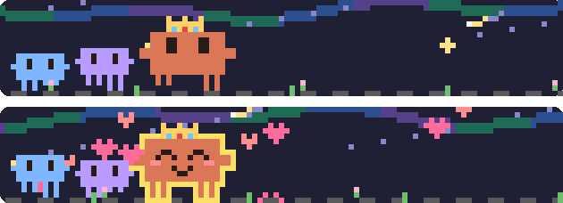

# clawd-parade



Claude Code の入力欄の上で、Clawd が行進する mod です。Claude が作業している間は歩き、サブエージェントが動くと仲間が増え、終わると状態に合わせて表情が変わります。なでて ♡ を貯める「なでなでゲーム」つき。

> 非公式のファンメイド mod です。Clawd は Anthropic の Claude Code のマスコットです。

## できること

- 作業中は Clawd が行進。許可待ち・質問・プラン・完了・指示待ち・エラー・中断など、状態ごとに表情とセリフが変わる
- サブエージェントの数だけ仲間（ミニ Clawd）が増え、種類ごとに毛色が違う
- 3 分放っておくと寝る（なでると起きる）
- 朝・昼・夕方・夜・深夜で空の色とあいさつが変わる（深夜はちょっと眠そう）。朝は右から朝日が昇り、昼は小さな太陽、夕方は左に夕日が沈む
- 日付で季節と行事のようすが変わる（PC のタイムゾーンの日付で、北半球の季節）。どれも小さく控えめで、飾りの枠には数えない
  - 春（3〜5 月）は花びらが舞い、夏（6〜8 月）は夜にほたる・晴れた昼に空に浮かぶ入道雲、秋（9〜11 月）は落ち葉、冬（12〜2 月）は地面にうすく雪
  - 行事の日は、庭のあいている場所に飾りが出る：クリスマス（12/24〜25）のツリー、お正月（1/1〜3）の門松、ハロウィン（10/31）のジャック・オ・ランタン、七夕（7/7）の笹、お月見（9/15）のおだんごと満月。場所が無ければ出ない
  - クリスマスは、サンタぼうしを持っていれば、選んだぼうしにかかわらずかぶる（見た目だけ）
  - 季節と行事のセリフも、ふだんのセリフにまざる（「さくら、きれいだね」「メリークリスマス！」「あけましておめでとう！」など）
- 日によって、晴れ・くもり・雨・雪になる。ほんとうの天気ではなく、日付から決まるつくりものの天気（ネットにはつながない。同じ日ならどのセッションでも同じ天気）
  - 1 日を朝〜昼・夕方・夜に分けて、それぞれに天気がある（たいていは 1 日同じ）。1 年をならすと晴れが 2/3 くらい。梅雨（6/5〜7/15）は雨が多く、雪は冬だけ。行事の日は晴れ（クリスマスは晴れか雪）
  - くもりは雲がゆっくり流れ、太陽がうすくなる。雨は斜めの雨つぶと水たまりで、星と太陽と流れ星はお休み。雪はちらちら降って、地面に雪が積もる。どれもまばらで、Clawd・仲間・飾りの奥にだけ描く
  - 買った飾り（夢のプレゼント・贈った星・オーロラ）はどの天気でも出る。♡ の稼ぎは天気で変わらない
  - 天気のセリフもまざる（「雨だね…」「かさ、持ってる？」「ゆきだ！」「くもってるね」など）。雪の日の Clawd は、ときどきうれしそうに目を細める
- `/parade cat` でねこのパレードに切り替え
- ターミナルとデスクトップアプリ（Code タブ）の両方で動く
  - ターミナル：半角ブロックのドット絵。マウスでなでる、仲間をクリックでぎゅっ
  - デスクトップ：SVG の空を帯いっぱいに広げ、セリフは空の右側に。絵を直接クリック・ドラッグでなでる

## なでなでゲーム

- なでると ♡ が貯まる。手を止めずになで続けるとコンボ、30 コンボで **フィーバー**（8 秒間 ♡×3、Clawd が金色に光ってハートの雨）
- Claude が作業中はなでなでの ♡ が 2 倍。放っておいても ♡ が入る
- `/parade shop` でショップ
  - 強化：やわらか手袋、ふわふわブラシ、コーヒー差し入れ、応援うちわ、ツールのおだちん、サブエージェント手当、フィーバー延長、星のかけら
    - フィーバー延長のほかは Lv の上限が無く、Lv25 ごとに効き目が 2 倍になる（Lv25 で ×2、Lv50 で ×4…）。ショップに次の節目まであと何 Lv かが出る
  - きせかえ：リボン、ねこみみ、サンタぼうし、王冠、流れ星、オーロラ（流れ星とオーロラは、買ったあと押すたびに出す・しまう）
  - プレゼント：♡ で Clawd に贈り物ができる。贈った ♡ の合計で「なかよし度」が上がる（しりあい → ともだち → なかよし → だいすき → しんゆう → あいぼう → ずっといっしょ → かぞく → うんめいのふたり → えいえん）
    - なかよしになるほど Clawd のようすが変わる：「だいすき」からあまえたあいさつが増え、「しんゆう」からは寝言とおわったときのひとこと、「あいぼう」からはひまなときにときどき手をふる（ねこは耳をぴくっ）。「かぞく」から上の段でも、セリフがひとつずつ増える
    - 小さな贈り物（何度でも）：クッキー、あったかいココア、いちごのショートケーキ、ありがとうの手紙、ふかふかクッション、新しいキーボード。Clawd がかかえてお礼を言い、しばらく「ごきげん」（♡×1.5）
    - 小さな贈り物の ☆ を押すと、帯にワンぽちで贈れるボタンが出る（もう一度押すと下ろす）。広いデスクトップでは、ボタンの代わりに夜空へ贈り物の札が出て、押すと贈れる
    - 夢のプレゼント（1 回きり）：全部グリーンのテスト、望遠鏡、小さなおうち、世界中の本がある図書館、Clawd 座、月への旅、バグのない世界、流れ星の丘（10 億 ♡）、空飛ぶ船（100 億）、Clawd の銅像（1000 億）、ふたりの星（1 兆）。庭や夜空に飾られて、ひとつごとに ♡ の稼ぎが +10%
      - 一度に飾れるのは、庭に 3 つ（旗・望遠鏡・おうち・図書館・月への旅のロケットと月・流れ星の丘・Clawd の銅像）、空に 2 つ（Clawd 座・虹・空飛ぶ船・ふたりの星）まで。贈ったものをショップで押すと「飾る／しまう」を切り替えられ、見出しの下に「庭 2/3・空 2/2」のように出る。しまっても ♡ の +10% やなかよし度、実績はそのまま
      - 選ぶまでは、場所ごとに高いものから飾る。新しく贈った夢は、枠があいていれば飾り、いっぱいならしまっておく
      - 空飛ぶ船とふたりの星は、行進の上のあいている空に、まわりの飾りや Clawd・仲間から 1 ドットあけて出る。あけられないとき（空の低い狭い端末で地面の飾りがいっぱい、仲間がとても多いなど）は、入るぶんだけ（高いほうから）
    - 星を贈る（何度でも）：1 個目は 1 億 ♡ で、贈るたびに値段が 1.6 倍。ひとつごとに ♡ の稼ぎが全部（なでなで・放置・お給料・おだちん・手当）ずっと ×1.2。贈った星は、昼も夜も空に明るい星（白い芯と桃色の光）として 12 個まで 1 つずつ増え、13 個目からは天の川が少しずつ濃くなる。1 億を稼いだころから遊んで、2〜3 週間で 1 兆、その先の京・垓まで伸び続けるくらいの速さ
- 実績（ショップで、取った数と一覧を見られる）
- きょうの日記（ショップの「きょうの日記」）：その日に Claude が働いた時間・ターン・ツールを使った回数・来てくれた仲間・なでた回数と、Clawd のひとこと。7 日ぶんの働いた時間の棒グラフ（▁〜█）、つづけていっしょに働いた日数（ターンが 1 回でも終わった日）といちばん長くつづいた日数、これまでの合計も出る
  - 日付は PC のタイムゾーンの日付。日をまたいだターンは、終わった日に数える。日記は 30 日ぶんだけ残す（合計といちばん長い日数は消えない）
  - 3・7・30 日つづける、1 日にツール 100 回、仲間が合わせて 100 匹、合わせて 100 時間、ターン 1,000 回の実績がある（♡ はもらえない）
  - 働いた時間は、同時に働いていたセッションのぶんも足す
- セッションをいくつ開いていても、♡・お買い物・実績は 1 つのセーブにまとまる。お仕事中のお給料は働いているセッションごとに、放置の ♡ はいくつ開いていても 1 つぶん入る
  - 別のセッションと同時に買って ♡ が足りなくなったら、♡ は負（借金）になる。同じものを両方で買ったら、1 つぶん返ってくる
- なでなでは mod の中だけで完結し、Claude への会話には何も送りません。作業中にいくらなでても邪魔になりません
- きょうの日記が保存するのは数だけです（日付ごとの時間と回数）。プロンプトの文・ファイルの名前・ツールの名前や引数は保存せず、mod の外へも何も送りません

## 入れ方

ターミナルの Claude Code で、次の 1 行を打ちます。

```
/plugin install clawd-parade --marketplace holmesfems/clawd-parade
```

マーケットプレイスを追加するか聞かれたら `y`、スコープはユーザー（いちばん上）を Enter で選びます。ユーザースコープで入れると、デスクトップアプリ（Code タブ）のセッションでも動きます。デスクトップの Code タブではこのコマンド自体が使えないので、入れるときはターミナルから打ってください。

## コマンド

| コマンド | |
| --- | --- |
| `/parade` | パレードの表示／非表示 |
| `/parade shop` | なでなでショップを開く |
| `/parade theme` | デスクトップのアプリの背景（テーマ）にパレードを描く（入れたままにすると次のセッションでも描く）。帯はセリフと「なでる」ボタンだけになる。もう一度打つと背景をもどす（ほかのプラグインのテーマも外れる） |
| `/parade clawd` ・ `/parade cat` | キャラ切り替え |
| `/parade debug` | なでなでの当たり判定をピンクの枠で表示（もう一度打つと消える） |
| `/parade debug 12/25` ・ `/parade debug today` | その日（月/日）の季節と行事で描いてみる（このセッションだけ・保存しない）。`today` で今日にもどる |
| `/parade debug rain` ・ `snow` ・ `cloudy` ・ `clear` | その天気で描いてみる（`雨`・`雪`・`くもり`・`晴れ` でも。このセッションだけ・保存しない）。`/parade debug today` で日付といっしょに今日にもどる |

## 開発

このリポジトリのフォルダで打ちます。

```
claude --plugin-dir .
claude plugin validate .
claude plugin test .
```

デスクトップアプリで試すときは、`~/.claude/settings.json` の `env` に `CLAUDE_CODE_PLUGIN_DIRS`（このフォルダの絶対パス）と `CLAUDE_CODE_PLUGIN_DIR_WATCH=1` を書くと、保存のたびに開いているセッションで読み込み直されます。

マーケットプレイスから入れた版（`clawd-parade@clawd-parade`）が有効なまま開発中のフォルダも読み込むと、同じ mod が二重に読み込まれるおそれがあります。開発しているあいだは入れた版を止め、終わったら戻します。

```
claude plugin disable clawd-parade@clawd-parade
claude plugin enable clawd-parade@clawd-parade
```

`tsconfig.json` は `.claude-plugin/types/`（Claude Code がこの mod を読み込むたびに書き出す型定義。git には入れていない）を extends しています。clone した直後は、一度 `claude --plugin-dir .` で読み込むまで、エディタで型が解決されません。

| ファイル | |
| --- | --- |
| `hooks/register.tsx` | フック本体（状態、保存、なでる・買う、コマンド） |
| `hooks/band.tsx` | 入力欄の上の帯の描画と、セリフ・♡ の行を作る `bandText` |
| `hooks/shop.tsx` | なでなでショップの描画 |
| `hooks/game.ts` | なでなでゲームのルール（♡、コンボ、お店、実績） |
| `hooks/diary.ts` | きょうの日記のルール（日ごとの数え方、つづけた日数、30 日より前を消す、ショップに出す文と棒グラフ） |
| `hooks/scene.ts` | 場面づくり（並び・当たり判定・なでる距離・`drawScene`） |
| `hooks/palette.ts` | 色（Clawd・仲間・小物の色、時間帯ごとの空と地面、毛色）と、時間帯・季節・行事の決め方 |
| `hooks/grid.ts` | ドット絵の土台（ピクセルの格子と、点・文字の表・小物を押す関数） |
| `hooks/sprites.ts` | キャラのドット絵（ねこ・子ねこ・Clawd・ミニ Clawd、顔、顔文字） |
| `hooks/decor.ts` | 飾り（ぼうし、贈り物、夢のプレゼント、太陽・流れ星などの空、ハート、贈り物の札） |
| `hooks/season.ts` | 季節と行事の飾り（花びら・ほたる・入道雲・落ち葉・雪、行事の地面の飾りと満月） |
| `hooks/weather.ts` | 天気（日付から決まる晴れ・くもり・雨・雪と、雲・雨つぶ・雪・水たまりの描き方） |
| `hooks/encode.ts` | 絵から端末セル・Text の並び・SVG への変換 |
| `hooks/parade-view.tsx` | ターミナルでなでるための Client |
| `hooks/touch-pad.tsx` | デスクトップで SVG に重ねる、見えない手ざわり層の Client |
| `types/index.d.ts` | 状態と保存（`$.store`）の型 |
| `.claude-plugin/icon.png` | プラグインのアイコン（`hooks/scene.ts` の `drawScene` で描いた、なでられてよろこぶ Clawd を真ん中に置き、1 ドット 36px に拡大した 792×792 の PNG） |
| `tests/` | `claude plugin test .` で動くテスト（`tests/simulate.ts` は毎日の遊び方をまねて ♡ の増え方を数える道具で、`tests/balance.test.ts` が星と節目と夢のプレゼントの値段を確かめる） |
| `.github/workflows/ci.yml` | PR と main への push で validate・test・version の確認を回す CI |
| `CHANGELOG.md` | 変更履歴 |

## リリース

入れた人の環境では、mod は version ごとのコピーで動きます。`.claude-plugin/plugin.json` の version を上げないと、push しても更新が届きません。

1. `claude plugin validate .` と `claude plugin test .` が通ることを確かめる（PR では GitHub Actions の CI が同じものを回す）
2. `.claude-plugin/plugin.json` の version を上げる（直しただけなら 3 つめ、機能を足したら 2 つめの数）
3. `CHANGELOG.md` に、その version で変わったことを書く
4. PR を merge して main に push する
5. 入れている環境で更新し、Claude Code を再起動する（開いているセッションは `/reload-plugins` でも読み込み直せる）

```
claude plugin update clawd-parade@clawd-parade
```

CI は、`hooks/`・`types/` を変えた PR で version が上がっているか、`CHANGELOG.md` のいちばん上の version が `plugin.json` と同じかも確かめます（`.github/scripts/check-version.mjs`。手元では `node .github/scripts/check-version.mjs origin/main`）。

`$.store` の `game`・`pets` は遊んでいる人の実データです。保存形式を変えるときは、`hooks/game.ts` の `SAVE_VERSION` を上げ、`restore` で古い形を読めるようにしてから出します。

## English

A Claude Code mod: Clawd marches above the prompt while Claude works, a friend joins for each subagent, and Clawd's face reacts to how the turn ended. Pet Clawd (click or drag) to earn ♡, chain combos into fevers, and spend ♡ in `/parade shop` on upgrades, cosmetics (hats, shooting stars, an aurora) and gifts for Clawd, from a cookie to dream gifts (a little house, a library, a trip to the moon, a world without bugs, a flying ship, a bronze statue of Clawd) that stay in the scene, and stars you can give again and again: each one multiplies all ♡ income and lights up the sky. The more you give, the closer you get: Clawd gains new lines, talks in its sleep, and waves at you. A work diary in the shop counts, per day, how long Claude worked, turns, tool calls, subagents and pets, with a 7-day bar chart and day streaks (only numbers are stored; no prompts, file names or tool arguments, and nothing leaves the mod). Works in the terminal and in the desktop app's Code tab. Install it from a terminal session:

```
/plugin install clawd-parade --marketplace holmesfems/clawd-parade
```

An unofficial fan-made mod. Clawd is the mascot of Anthropic's Claude Code.

## License

MIT
