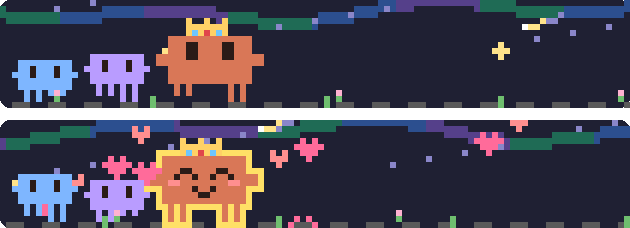

# clawd-parade



Claude Code の入力欄の上で、Clawd が行進する mod です。Claude が作業している間は歩き、サブエージェントが動くと仲間が増え、終わると状態に合わせて表情が変わります。なでて ♡ を貯める「なでなでゲーム」つき。

> 非公式のファンメイド mod です。Clawd は Anthropic の Claude Code のマスコットです。

## できること

- 作業中は Clawd が行進。許可待ち・質問・プラン・完了・指示待ち・エラー・中断など、状態ごとに表情とセリフが変わる
- サブエージェントの数だけ仲間（ミニ Clawd）が増え、種類ごとに毛色が違う
- 3 分放っておくと寝る（なでると起きる）
- `/parade cat` でねこのパレードに切り替え
- ターミナルとデスクトップアプリ（Code タブ）の両方で動く
  - ターミナル：半角ブロックのドット絵。マウスでなでる、仲間をクリックでぎゅっ
  - デスクトップ：SVG の夜空を帯いっぱいに広げ、セリフは空の右側に。絵を直接クリック・ドラッグでなでる

## なでなでゲーム

- なでると ♡ が貯まる。手を止めずになで続けるとコンボ、30 コンボで **フィーバー**（8 秒間 ♡×3、Clawd が金色に光ってハートの雨）
- Claude が作業中はなでなでの ♡ が 2 倍。放っておいても ♡ が入る
- `/parade shop` でショップ
  - 強化：やわらか手袋、ふわふわブラシ、コーヒー差し入れ、応援うちわ、ツールのおだちん、サブエージェント手当、フィーバー延長、星のかけら
  - きせかえ：リボン、ねこみみ、サンタぼうし、王冠、流れ星、オーロラ
  - プレゼント：♡ で Clawd に贈り物ができる。贈った ♡ の合計で「なかよし度」が上がる（しりあい → … → ずっといっしょ）
    - 小さな贈り物（何度でも）：クッキー、あったかいココア、いちごのショートケーキ、ありがとうの手紙、ふかふかクッション、新しいキーボード。Clawd がかかえてお礼を言い、しばらく「ごきげん」（♡×1.5）
    - 夢のプレゼント（1 回きり）：全部グリーンのテスト、望遠鏡、小さなおうち、世界中の本がある図書館、Clawd 座、月への旅、バグのない世界。夜空と庭にずっと飾られて、ひとつごとに ♡ の稼ぎが +10%
- 実績（ショップで、取った数と一覧を見られる）
- セッションをいくつ開いていても、♡・お買い物・実績は 1 つのセーブにまとまる。お仕事中のお給料は働いているセッションごとに、放置の ♡ はいくつ開いていても 1 つぶん入る
  - 別のセッションと同時に買って ♡ が足りなくなったら、♡ は負（借金）になる。同じものを両方で買ったら、1 つぶん返ってくる
- なでなでは mod の中だけで完結し、Claude への会話には何も送りません。作業中にいくらなでても邪魔になりません

## 入れ方

ターミナルの Claude Code で、次の 1 行を打ちます。

```
/plugin install clawd-parade --marketplace holmesfems/clawd-parade
```

マーケットプレイスを追加するか聞かれたら `y`、スコープはユーザー（いちばん上）を Enter で選びます。ユーザースコープで入れると、デスクトップアプリ（Code タブ）のセッションでも動きます。デスクトップの Code タブではこのコマンド自体が使えないので、入れるときはターミナルから打ってください。

## コマンド

| コマンド | |
| --- | --- |
| `/parade` | パレードの表示／非表示 |
| `/parade shop` | なでなでショップを開く |
| `/parade clawd` ・ `/parade cat` | キャラ切り替え |
| `/parade debug` | なでなでの当たり判定をピンクの枠で表示（もう一度打つと消える） |

## 開発

このリポジトリのフォルダで打ちます。

```
claude --plugin-dir .
claude plugin validate .
claude plugin test .
```

デスクトップアプリで試すときは、`~/.claude/settings.json` の `env` に `CLAUDE_CODE_PLUGIN_DIRS`（このフォルダの絶対パス）と `CLAUDE_CODE_PLUGIN_DIR_WATCH=1` を書くと、保存のたびに開いているセッションで読み込み直されます。

マーケットプレイスから入れた版（`clawd-parade@clawd-parade`）が有効なまま開発中のフォルダも読み込むと、同じ mod が二重に読み込まれるおそれがあります。開発しているあいだは入れた版を止め、終わったら戻します。

```
claude plugin disable clawd-parade@clawd-parade
claude plugin enable clawd-parade@clawd-parade
```

`tsconfig.json` は `.claude-plugin/types/`（Claude Code がこの mod を読み込むたびに書き出す型定義。git には入れていない）を extends しています。clone した直後は、一度 `claude --plugin-dir .` で読み込むまで、エディタで型が解決されません。

| ファイル | |
| --- | --- |
| `hooks/register.tsx` | フック本体（状態、保存、なでる・買う、コマンド） |
| `hooks/band.tsx` | 入力欄の上の帯の描画と、セリフ・♡ の行を作る `bandText` |
| `hooks/shop.tsx` | なでなでショップの描画 |
| `hooks/game.ts` | なでなでゲームのルール（♡、コンボ、お店、実績） |
| `hooks/scene.ts` | ドット絵（パレード、ぼうし、夜空の飾り）と SVG・端末セルへの変換 |
| `hooks/parade-view.tsx` | ターミナルでなでるための Client |
| `hooks/touch-pad.tsx` | デスクトップで SVG に重ねる、見えない手ざわり層の Client |
| `types/index.d.ts` | 状態と保存（`$.store`）の型 |
| `tests/` | `claude plugin test .` で動くテスト |
| `.github/workflows/ci.yml` | PR と main への push で validate・test・version の確認を回す CI |
| `CHANGELOG.md` | 変更履歴 |

## リリース

入れた人の環境では、mod は version ごとのコピーで動きます。`.claude-plugin/plugin.json` の version を上げないと、push しても更新が届きません。

1. `claude plugin validate .` と `claude plugin test .` が通ることを確かめる（PR では GitHub Actions の CI が同じものを回す）
2. `.claude-plugin/plugin.json` の version を上げる（直しただけなら 3 つめ、機能を足したら 2 つめの数）
3. `CHANGELOG.md` に、その version で変わったことを書く
4. PR を merge して main に push する
5. 入れている環境で更新し、Claude Code を再起動する（開いているセッションは `/reload-plugins` でも読み込み直せる）

```
claude plugin update clawd-parade@clawd-parade
```

CI は、`hooks/`・`types/` を変えた PR で version が上がっているか、`CHANGELOG.md` のいちばん上の version が `plugin.json` と同じかも確かめます（`.github/scripts/check-version.mjs`。手元では `node .github/scripts/check-version.mjs origin/main`）。

`$.store` の `game`・`pets` は遊んでいる人の実データです。保存形式を変えるときは、`hooks/game.ts` の `SAVE_VERSION` を上げ、`restore` で古い形を読めるようにしてから出します。

## English

A Claude Code mod: Clawd marches above the prompt while Claude works, a friend joins for each subagent, and Clawd's face reacts to how the turn ended. Pet Clawd (click or drag) to earn ♡, chain combos into fevers, and spend ♡ in `/parade shop` on upgrades, cosmetics (hats, shooting stars, an aurora) and gifts for Clawd, from a cookie to dream gifts (a little house, a library, a trip to the moon, a world without bugs) that stay in the scene. Works in the terminal and in the desktop app's Code tab. Install it from a terminal session:

```
/plugin install clawd-parade --marketplace holmesfems/clawd-parade
```

An unofficial fan-made mod. Clawd is the mascot of Anthropic's Claude Code.

## License

MIT
